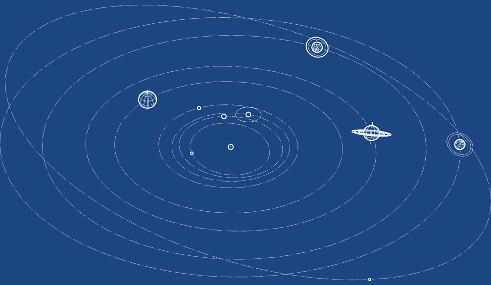
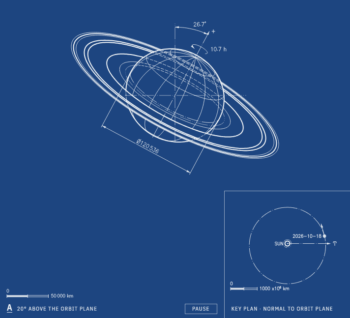
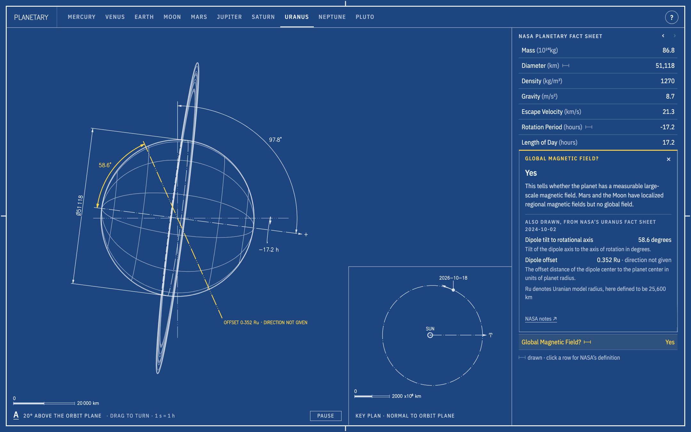

# Planetary

NASA's [Planetary Fact Sheet](https://nssdc.gsfc.nasa.gov/planetary/factsheet/), drawn as a set of
engineering drawings. Every dimension on a body's sheet is a number from NASA's tables, or is worked
out from one and shows its formula.

Unofficial: not affiliated with or endorsed by NASA.

[Open it](https://eduardmur.github.io/planetary/) ·
[Saturn](https://eduardmur.github.io/planetary/saturn/) ·
[Uranus](https://eduardmur.github.io/planetary/uranus/#magneticField) ·
[Pluto](https://eduardmur.github.io/planetary/pluto/#orbitalInclination)



The home page is a schematic of the solar system. The planets move on their orbits at 1 minute = 1
year, starting from today's positions. Point at one to see its name; click it to open its sheet. Each of
the ten bodies in NASA's table has a sheet: Mercury, Venus, Earth, the Moon, Mars, Jupiter, Saturn,
Uranus, Neptune and Pluto.



## Reading a sheet

- Click a row of NASA's table, or a line in the drawing. What it measures turns yellow, and a popover
  opens over the table, under the row or above it (at the bottom of the screen on a phone held
  upright). It holds NASA's definition, the value as a multiple of Earth's, any values the drawing takes
  from the body's own fact sheet, and the places where NASA's pages disagree about it. Hovering opens
  nothing.
- While a definition is open, ‹ › step to the previous or next row: above the table, or in the
  popover itself on a phone. ↑ and ↓ do the same.
- Rows marked ⊢⊣ have a shape and are drawn. The others (mass, density, temperature and so on) are
  listed exactly as NASA gives them and are not drawn.
- View A shows the body from 20° above its orbit plane. Drag it sideways to turn it. Selecting the
  obliquity turns it into the orbit plane, where the tilt shows at its true size.
- The key plan shows the orbit seen square-on. Selecting the orbital inclination turns it edge-on, for
  the same reason.
- The tabs, and ← and →, move between bodies and keep the selected row.
- "?" opens the sheet's notes, its sources with NASA's dates, and the title block.
- The lines follow ISO 128:
  - thick: outlines, and the edges of the opaque rings (Saturn's A and B rings, Uranus's ε ring);
  - thin: the latitude and longitude grid, and the fainter rings;
  - dashed: anything hidden, such as rings behind the planet or the core;
  - long dash and dot: axes, the equator and orbits;
  - long dash and two dots: reference lines, such as the orbit normal, Earth's orbit and the magnetic
    dipole, and the faintest rings (optical depth under about 0.01).



## What is to scale

- On a body's sheet, sizes, tilts, ring radii and orbits are drawn to scale from NASA's values. Each
  view has its own scale bar.
- Every body spins at 1 second = 1 hour. Jupiter turns in 9.9 seconds. Venus takes 97 minutes and
  looks still, which is what it does.
- Positions are for today. They come from NASA's J2000 mean orbital elements and Kepler's equation, and
  stay within 0.5° of JPL Horizons from 1990 to 2060 (0.3° for every body except Mercury).
- The home page is a schematic and is not to scale. Distances from the Sun are compressed: a point at
  r × 10⁶ km is drawn at R·(r / 7375.9)^0.4, where 7375.9 is Pluto's aphelion and R fits the window.
  The planets are symbols whose diameters grow with the square root of NASA's. Directions, inclinations
  and each planet's pole of rotation are true.

## The data

`src/data/factsheet.json` holds every value from the NASA pages the sheets use: the main table, the
ratio table, each body's page and the four ring pages. Each value keeps NASA's own text (`"~41,900"`,
`"16,298."`) next to its number, with footnote markers such as `*` in a field of their own. The raw
pages are kept in `data/raw/`, with their SHA-256 hashes and the date they were downloaded.

NASA's pages sometimes disagree with each other. For example, the main table gives Pluto's eccentricity
as 0.244, but the perihelion and aphelion in the same table give 0.2488. The sheets do not choose
between them: each value is shown where NASA prints it, and each line is sized by the value printed on
it. [`data/discrepancies.md`](data/discrepancies.md) lists every place where NASA's pages disagree, with
each other or within one page: 18 conflicts and 103 differences that are only rounding. Each conflict
also shows in the popover of the row it concerns.
[DATA.md](DATA.md) explains the sources, the parsing rules and the schema.

The tests check that:

- every parsed value appears verbatim in its source page;
- every drawn size equals the number printed on it;
- Venus, Uranus and Pluto, and only they, turn clockwise seen from the north side of their orbits;
- positions match JPL Horizons.

## Run it

```sh
npm install
npm run dev        # http://localhost:5173/planetary/
npm test           # unit tests
npm run build
npm run e2e        # browser tests against the build
```

To refresh the data from NASA, run `npm run data:fetch`, then `npm run data:parse`, then
`node scripts/ledger.ts`. A weekly GitHub Action does the same and opens a pull request when NASA's
pages change.

## How it is made

There is no WebGL and no framework. A small renderer in `src/draw/` projects spheroids, rings and orbits
with an orthographic camera, finds the hidden lines analytically and writes SVG. The lettering uses the
single-stroke Hershey font, drawn with the same pen as the lines. Each sheet is a static HTML page with
its table already in place, and the client script is about 35 kB gzipped.

## Credits and licences

- Data: NASA Space Science Data Coordinated Archive (NSSDCA), Planetary Fact Sheets, curated by
  Dr. David R. Williams. The data is a US Government work and in the public domain. The JSON and CSV
  here are CC0.
- Code: [MIT](LICENSE).
- Fonts: the Hershey fonts were originally created by Dr. A. V. Hershey while working at the U. S.
  National Bureau of Standards. IBM Plex Sans Condensed is used under the SIL Open Font License.

See [CREDITS.md](CREDITS.md).
